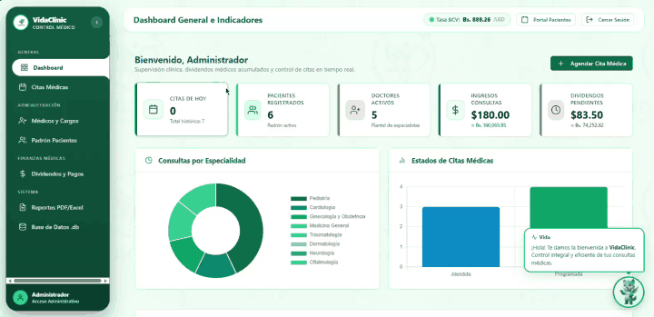
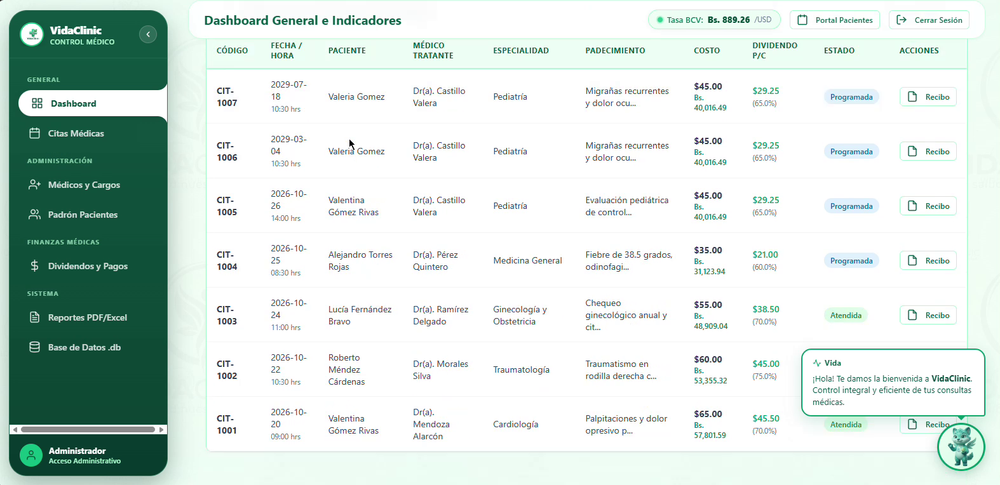
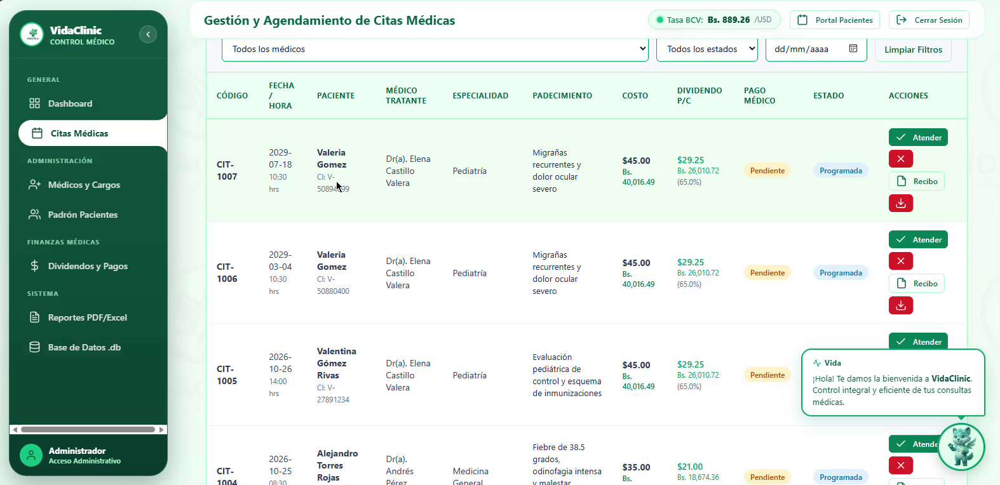
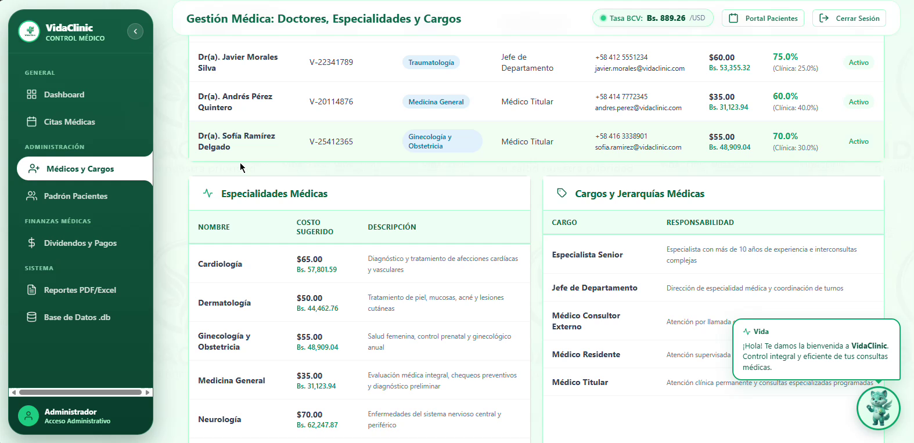
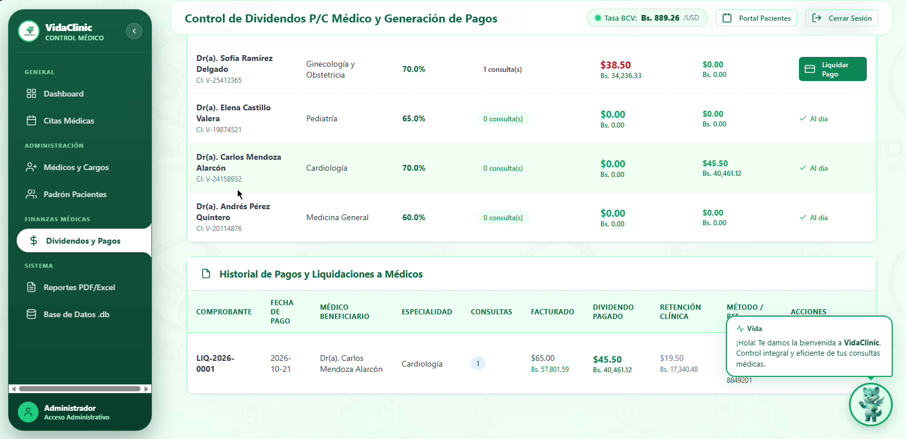
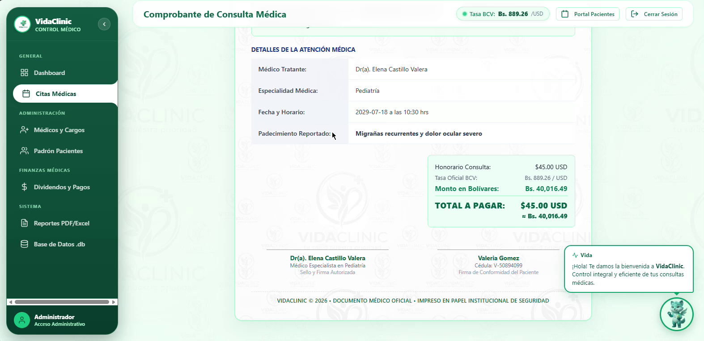
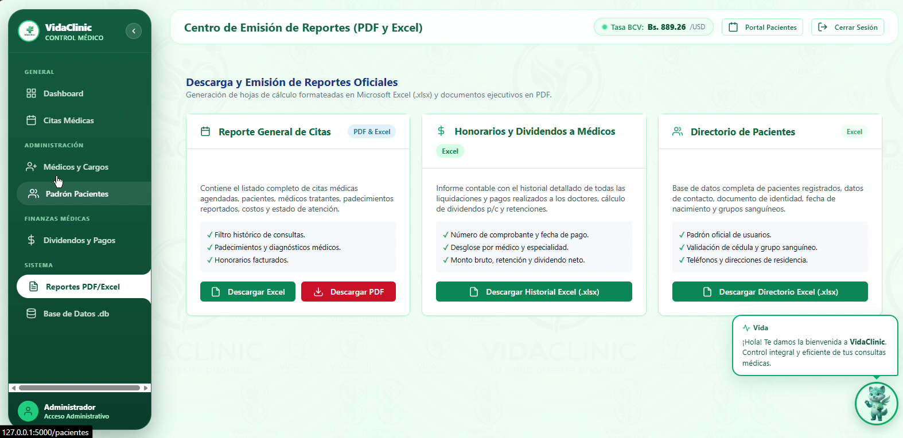
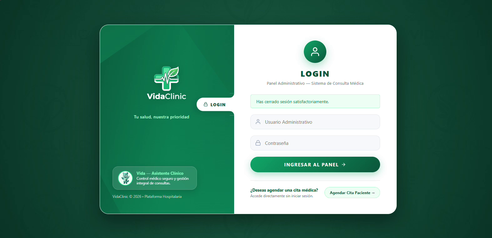
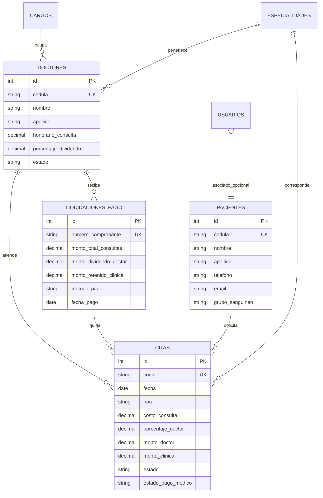

<div align="center">

  

  # 🏥 VidaClinic
  ### Sistema Integral de Gestión Hospitalaria, Consulta Médica y Liquidación Financiera

  <p align="center">
    <b>Plataforma web médica full-stack diseñada como solución integral para centros de salud, clínicas privadas y policonsultorios médicos. Integra portal de autoservicio para pacientes, motor de liquidación contable de dividendos médicos (p/c), generación de reportes corporativos en PDF/Excel con membrete personalizado, y sincronización en tiempo real con la tasa oficial del Banco Central de Venezuela (BCV).</b>
  </p>

  <p align="center">
    
    
    
    
    
    
    
    <a href="LICENSE.txt"></a>
  </p>

  <p align="center">
    <a href="#-recorrido-visual-del-sistema">Recorrido Visual</a> •
    <a href="#-galer%C3%ADa-de-m%C3%B3dulos-principales">Galería de Módulos</a> •
    <a href="#-capacidades-y-arquitectura-funcional">Capacidades Funcionales</a> •
    <a href="#-stack-tecnol%C3%B3gico">Stack Tecnológico</a> •
    <a href="#-modelo-relacional-de-base-de-datos">Base de Datos</a> •
    <a href="#-referencia-de-api">API BCV</a> •
    <a href="#-autor">Autor</a>
  </p>

  <br>

  <!-- ANIMATED DEMO WALKTHROUGH -->
  
  <br>
  <sub><i>Demostración interactiva de navegación fluida, indicadores en tiempo real y módulos de gestión hospitalaria</i></sub>

  <br><br>
  
  <br>
  <sub><i>"Vida" — Mascota y Guardiana de VidaClinic</i></sub>

</div>

---

## 📌 Visión General del Proyecto

**VidaClinic** es una pieza de software desarrollada con foco en arquitectura limpia, robustez de datos y experiencia de usuario para el sector salud. 

El sistema centraliza el flujo asistencial y administrativo completo de una clínica:
1. **Atención al Paciente:** Portal público sin barreras de entrada para agendamiento ágil y comprobantes inmediatos.
2. **Control Clínico:** Catálogos de especialidades, jerarquías de cargos médicos y prevención de conflictos de horario.
3. **Gestión Financiera Hospitalaria:** Liquidación automática de honorarios médicos con cálculo de dividendos porcentuales (p/c), retenciones institucionales y facturación bimonetaria en tiempo real (USD y Bs.) respaldada por la API oficial del Banco Central de Venezuela.
4. **Inteligencia y Reportería:** Emisión de recibos con marca de agua institucional y reportes ejecutivos vectorizados en PDF y hojas de cálculo en Excel.

---

## 📸 Galería de Módulos Principales

<div align="center">

### 📊 Dashboard Ejecutivo & KPIs en Tiempo Real

<p align="center"><i>Panel de control con métricas financieras, balance de consultas, estatus de dividendos y widget dinámico de tasa oficial BCV.</i></p>

<br>

### 🗓️ Gestión Central de Citas Médicas & Precios Duales

<p align="center"><i>Tabla interactiva con control de estados (Programada, Atendida, Cancelada), desglose de honorarios en USD y Bolívares, y atención médica con diagnóstico.</i></p>

<br>

### 👨‍⚕️ Padrón de Especialistas & Jerarquías Médicas

<p align="center"><i>Administración de doctores, tarifas por consulta, porcentaje de dividendo pactado, especialidades y cargos institucionales.</i></p>

<br>

### 💰 Motor de Dividendos y Liquidación a Médicos

<p align="center"><i>Cálculo automatizado de dividendos médicos por consulta (p/c), balance de pendientes, emisión de pagos por lote y auditoría financiera.</i></p>

<br>

### 🧾 Comprobante Digital con Membrete y Fondo Clínico

<p align="center"><i>Recibo digital con diseño sobre papel membretado de alta resolución, código único de atención y doble denominación cambiaria.</i></p>

<br>

### 📈 Centro de Emisión de Reportes (PDF y Excel)

<p align="center"><i>Generación de informes contables en Microsoft Excel (.xlsx) con formato tabular y documentos ejecutivos listos para imprimir en PDF.</i></p>

<br>

### 🔐 Portal de Acceso y Branding Institucional

<p align="center"><i>Interfaz de autenticación administrativa protegida con acceso directo al agendamiento público para pacientes.</i></p>

</div>

---

## 🚀 Capacidades y Arquitectura Funcional

### 💵 1. Conversión Cambiaria Oficial en Tiempo Real (API BCV)
- **Sincronización Continua:** Consumo directo de la API oficial del Banco Central de Venezuela (`ve.dolarapi.com/v1/dolares/oficial`).
- **Resiliencia & Caché Híbrido:** Algoritmo con caché en memoria volátil de 30 minutos y respaldo persistente en archivo JSON (`database/tasa_bcv_cache.json`) que garantiza operatividad ininterrumpida aun ante caídas de conectividad externa.
- **Doble Denominación:** Despliegue simultáneo de precios en **$ USD** y **Bs.** en todas las tablas, selectores dinámicos, recibos y reportes.
- **Filtros Jinja Personalizados:** Integración nativa en plantillas con `{{ monto | to_bs }}` y `{{ monto | usd_to_bs_val }}`.

### 🩺 2. Portal de Pacientes & Prevención de Conflictos
- **Acceso Sin Fricción:** Agendamiento autónomo desde `/agendar-cita` sin requerir registro de usuario ni credenciales.
- **Anti-Collision Engine:** Algoritmo que valida en milisegundos que no existan colisiones de fecha, hora y doctor antes de confirmar una cita.
- **Ficha Imprimible Instantánea:** Generación automática de comprobante digital y descarga en PDF.

### 💼 3. Motor Contable de Dividendos por Consulta (p/c)
- **Distribución Paramétrica:** División porcentual individual por especialista (ej. 70% médico / 30% clínica).
- **Procesamiento de Pagos por Lote:** Conciliación selectiva con cálculo dinámico en tiempo real en frontend y backend.
- **Trazabilidad Contable:** Registro de método de pago (transferencia bancaria, pago móvil, cheque, efectivo), números de comprobante único (`LIQ-YYYY-XXXX`) y notas contables.

### 📑 4. Motores de Reportería Corporativa
- **ReportLab (PDF Vectorizado):** Comprobantes de consulta, órdenes médicas y liquidaciones generadas con resolución de imprenta, tipografías estructuradas y aplicación de marca de agua institucional (`recibo_bg_letter.jpg`).
- **OpenPyXL (Excel .xlsx):** Libros contables con celdas combinadas, encabezados corporativos con paleta verde clínica (`#047857`), formato de moneda monetario y ajuste automático de ancho de columnas.

### 🛡️ 5. Capa de Seguridad y Validación de Integridad
- **Sanitización Estricta:** Validadores regex para nombres y apellidos (solo letras y acentos), documentos de identidad (cédulas venezolanas formato `V-` / `E-`), teléfonos y correos electrónicos.
- **Validación Cronológica:** Bloqueo de fechas pasadas en agendamientos médicos.
- **Criptografía:** Hash de contraseñas con algoritmo seguro **SHA-256**.
- **Gestión de Base de Datos:** Exportación con un solo clic de la copia de seguridad física de SQLite3 (`.db`).

---

## 🛠️ Stack Tecnológico

| Capa / Ecosistema | Tecnología | Justificación y Rol |
| :--- | :--- | :--- |
| **Lenguaje Backend** | **Python 3.12+** | Tipado fuerte, rendimiento eficiente y ecosistema sólido de librerías |
| **Framework Web** | **Flask 3.0+** | Microframework modular con motor de plantillas Jinja2 y decoradores de autenticación |
| **Base de Datos** | **SQLite3 Relacional** | Motor embebido ACID con integridad referencial (`PRAGMA foreign_keys = ON`) |
| **Reportería PDF** | **ReportLab 4.x** | Renderizado vectorial programático de alta precisión tipográfica |
| **Hojas de Cálculo** | **OpenPyXL 3.1+** | Generación de reportes tabulares nativos para Microsoft Excel |
| **Integración Externa**| **API REST BCV (DolarAPI)** | Ingesta de tipo de cambio oficial del Banco Central de Venezuela |
| **Frontend UI/UX** | **HTML5 Semántico + CSS3 Puro** | Diseño clínico verde esmeralda responsivo, sin frameworks pesados |
| **Seguridad** | **SHA-256 Cryptographic Hash** | Cifrado y control de sesiones mediante tokens seguros |

---

## 🗄️ Modelo Relacional de Base de Datos



---

## 📡 Referencia de API: `/api/tasa-bcv`

El sistema expone un endpoint JSON para consulta y consumo de la tasa cambiaria oficial vigente:

- **Método:** `GET`
- **Ruta:** `/api/tasa-bcv`
- **Respuesta de Ejemplo:**
```json
{
  "fuente": "Banco Central de Venezuela (BCV)",
  "moneda": "USD",
  "simbolo": "Bs.",
  "tasa": 889.2553,
  "promedio": 889.26,
  "fecha": "01/11/2026",
  "fecha_actualizacion": "2026-11-01T04:53:23.120"
}
```

---

## 👤 Autor & Contacto

Desarrollado y diseñado con dedicación por:

**Eduardo Contreras**  
- **GitHub:** [@ejcb11](https://github.com/ejcb11)  
- **Correo Electrónico:** [ejcb2006@gmail.com](mailto:ejcb2006@gmail.com)  

---

## 📄 Derechos de Autor & Licencia

Este proyecto y su código fuente son una obra intelectual original de **Eduardo Contreras** creada con fines exclusivos de **exhibición y evaluación técnica en portafolio profesional**.

© 2026 **Eduardo Contreras**. Todos los derechos reservados.  
Queda terminantemente prohibida la reproducción, copia, distribución, modificación o uso comercial no autorizado de este software sin el consentimiento previo y por escrito del autor. Para términos completos, consulta el archivo [LICENSE.txt](LICENSE.txt).
