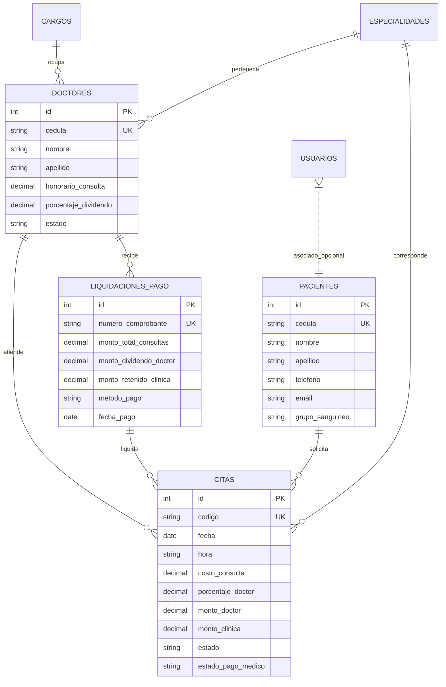

<div align="center">

  

  # 🏥 VidaClinic
  ### Sistema Integral de Gestión Hospitalaria, Consulta Médica y Liquidación Financiera

  <p align="center">
    <b>Plataforma web médica full-stack desarrollada en Python y Flask con base de datos relacional SQLite3, portal de autoservicio para pacientes, motor de liquidación contable de dividendos médicos (p/c), generación de reportes ejecutivos en PDF/Excel con membrete personalizado, y sincronización en tiempo real con la tasa oficial del Banco Central de Venezuela (BCV).</b>
  </p>

  <p align="center">
    <a href="https://www.python.org/"></a>
    <a href="https://flask.palletsprojects.com/"></a>
    <a href="https://www.sqlite.org/"></a>
    <a href="https://www.reportlab.com/"></a>
    <a href="https://openpyxl.readthedocs.io/"></a>
    <a href="https://ve.dolarapi.com/"></a>
    <a href="LICENSE"></a>
  </p>

  <p align="center">
    <a href="#-demostración-rápida">Demostración Rápida</a> •
    <a href="#-características-principales">Características</a> •
    <a href="#-conversión-cambiaria-bcv">Conversión BCV</a> •
    <a href="#-portal-público-de-pacientes">Portal Pacientes</a> •
    <a href="#-motor-de-dividendos-médicos">Dividendos Médicos</a> •
    <a href="#-arquitectura-y-base-de-datos">Arquitectura</a> •
    <a href="#-instalación-y-despliegue">Instalación</a> •
    <a href="#-autor">Autor</a>
  </p>

  
  <br>
  <sub><i>"Vida" — Mascota y Guardiana de VidaClinic</i></sub>

</div>

---

## 📌 Descripción del Proyecto

**VidaClinic** es una solución tecnológica integral diseñada para optimizar los procesos operativos, asistenciales y contables de centros de salud, clínicas privadas y policonsultorios médicos. 

Desarrollada bajo estándares de arquitectura limpia y mejores prácticas de ingeniería de software, la plataforma resuelve la brecha entre la atención al paciente y la gestión administrativa hospitalaria, automatizando desde el agendamiento sin colisiones hasta el cálculo matemático de dividendos a especialistas y la facturación bimonetaria en Dólares ($ USD) y Bolívares (Bs.).

---

## 🚀 Características Principales

### 🩺 1. Portal Público de Autoservicio para Pacientes
- **Agendamiento directo y sin fricción:** Los pacientes pueden programar sus consultas médicas desde `/agendar-cita` sin necesidad de crear contraseñas ni iniciar sesión previa.
- **Detección inteligente de horarios y prevención de colisiones:** Validación de solapamiento de agenda por doctor, día y bloque horario.
- **Comprobante Digital y Ficha Médica en PDF:** Generación instantánea de comprobante imprimible con membrete oficial, código de cita único, monto de la consulta y recomendaciones previas.

### 💵 2. Motor de Conversión Cambiaria Oficial en Vivo (API BCV)
- **Integración con la API oficial del Banco Central de Venezuela:** Consulta asíncrona a través de servicio REST con sistema de caché de memoria y respaldo persistente en disco (`database/tasa_bcv_cache.json`) ante contingencias de red.
- **Precios duales en toda la plataforma:** Visualización instantánea de costos en dólares ($ USD) y bolívares (Bs.) en el catálogo de especialidades, honorarios de doctores, balance del dashboard y recibos de pago.
- **Topbar Live Widget:** Indicador visual en la barra superior con estatus de sincronización y fecha de actualización oficial.
- **API Endpoint público interno:** Ruta `/api/tasa-bcv` para consumo de datos financieros en tiempo real.

### 💼 3. Liquidación Contable y Dividendos Médicos (p/c)
- **Cálculo de honorarios por consulta médica:** Distribución porcentual configurable por médico (ej: 70% especialista / 30% clínica).
- **Procesamiento de pagos por lotes:** Selección de consultas atendidas para emisión agrupada de liquidación.
- **Recibos de liquidación oficiales:** Emisión de comprobantes contables con desglose de retención, método de pago (transferencia, pago móvil, efectivo, cheque) y número de referencia.
- **Fondo de agua institucional en PDF:** Generación de recibos ejecutivos impresos sobre papel membretado clínico en alta resolución (`recibo_bg_letter.jpg`).

### 📊 4. Dashboard Ejecutivo y Métricas en Tiempo Real
- **KPIs gerenciales:** Citas del día, pacientes activos registrados, médicos tratantes en nómina, ingresos brutos y saldo pendiente por liquidar a doctores.
- **Registro de auditoría médica:** Diagnósticos clínicos, observaciones post-consulta y trazabilidad del estado (`Programada`, `Atendida`, `Cancelada`).

### 📑 5. Centro de Reportes Corporativos (PDF y Excel)
- **Exportación en Microsoft Excel (.xlsx):** Hojas de cálculo formateadas mediante `openpyxl` con estilos tipográficos, encabezados institucionales, bordes y columnas numéricas monetarias.
- **Documentos PDF ejecutivos:** Vectorizados con `reportlab` listos para impresión o archivo físico.
- **Descarga y resguardo de la Base de Datos:** Exportación con un solo clic de la copia de seguridad física de SQLite3 (`.db`).

### 🛡️ 6. Validaciones Estrictas y Seguridad de Datos
- **Filtros sanitizadores:** Expresiones regulares para control de nombres y apellidos (solo caracteres alfabéticos y acentos), validación de cédulas de identidad (formato V- / E-), números telefónicos venezolanos (+58) y correos electrónicos corporativos.
- **Validación cronológica:** Bloqueo automático de fechas retroactivas en agendamientos médicos.

---

## 🏗️ Arquitectura y Tecnologías

```
vidaclinic/
├── app.py                      # Servidor web Flask, rutas, API endpoints y lógica de negocio
├── bcv.py                      # Cliente API oficial BCV, algoritmo de caché y conversor de divisas
├── reports.py                  # Generador de reportes corporativos en Excel (.xlsx) y PDF
├── validators.py               # Capa de sanitización y validaciones regex de formularios
├── test_app.py                 # Suite de pruebas unitarias y de integración end-to-end
├── requirements.txt            # Dependencias del ecosistema Python
├── database/
│   ├── db.py                   # Capa de acceso a datos (DAO), consultas parametrizadas SQLite
│   ├── init_db.py              # Script de inicialización y poblado de datos demo semilla
│   └── schema.sql              # Esquema DDL relacional con llaves foráneas e índices
├── static/
│   ├── css/
│   │   └── style.css           # Estilos clínicos responsivos, variables CSS y diseño moderno
│   └── images/                 # Identidad corporativa, logos vectoriales y fondos membretados
└── templates/                  # Motor de plantillas Jinja2
    ├── base.html               # Layout maestro con sidebar interactivo y widget BCV
    ├── dashboard.html          # Panel de control ejecutivo y métricas
    ├── login.html              # Pantalla de acceso administrativo y banner de pacientes
    ├── citas/                  # Agendamiento público, comprobantes y gestión de turnos
    ├── medicos/                # Padrón de especialistas, especialidades y cargos
    ├── pacientes/              # Directorio e historias de pacientes
    ├── dividendos/             # Módulo de liquidación financiera y recibos de médicos
    └── reportes/               # Centro de descarga de reportes Excel y PDF
```

### Stack Tecnológico

| Capa | Herramienta | Propósito |
| :--- | :--- | :--- |
| **Backend** | Python 3.12+ / Flask 3.0 | Núcleo de la aplicación web, enrutamiento y lógica de negocio |
| **Base de Datos** | SQLite3 Relacional | Almacenamiento local ACID con llaves foráneas (`PRAGMA foreign_keys = ON`) |
| **Generador PDF** | ReportLab 4.x | Renderizado programático de documentos vectorizados de alta calidad |
| **Generador Excel** | OpenPyXL 3.1+ | Creación y formateo de hojas de cálculo de auditoría administrativa |
| **Integración Externa**| DolarAPI / BCV API | Sincronización oficial del tipo de cambio Banco Central de Venezuela |
| **Frontend** | HTML5 Semántico + CSS3 Puro | Interfaz hospitalaria sin librerías pesadas, rápida y responsiva |
| **Seguridad** | SHA-256 + Decoradores | Protección de rutas administrativas y hashes criptográficos |

---

## 🗄️ Modelo Relacional de Base de Datos



---

## ⚡ Instalación y Despliegue Local

### 1. Clonar el Repositorio
```bash
git clone https://github.com/ejcb11/vidaclinic-sistema-medico.git
cd vidaclinic-sistema-medico
```

### 2. Crear y Activar un Entorno Virtual (Recomendado)
```bash
# En Windows (PowerShell):
python -m venv venv
.\venv\Scripts\Activate.ps1

# En Linux / macOS:
python3 -m venv venv
source venv/bin/activate
```

### 3. Instalar Dependencias
```bash
pip install -r requirements.txt
```
*(En Windows también puedes ejecutar simplemente `instalar_dependencias.bat` o `instalar_dependencias.ps1`)*

### 4. Inicializar la Base de Datos (Opcional - Se crea automáticamente)
El sistema genera e inicializa automáticamente la base de datos con catálogo de demostración en su primer arranque. Si deseas reiniciar los datos manualmente:
```bash
python database/init_db.py
```

### 5. Ejecutar la Aplicación
```bash
python app.py
```
*(O haciendo doble clic sobre `run.bat` / ejecutando `run.ps1` en Windows)*

### 6. Acceder a la Plataforma
Abre tu navegador web en:
👉 **[http://127.0.0.1:5000](http://127.0.0.1:5000)**

---

## 🔑 Credenciales de Acceso al Sistema

| Módulo / Rol | Usuario | Contraseña | Permisos |
| :--- | :--- | :--- | :--- |
| **Panel Administrativo** | `admin` | `admin123` | Control total: Citas, Médicos, Pacientes, Finanzas, Liquidación y Reportes |
| **Portal Pacientes** | *(Sin login)* | *(Libre)* | Agendamiento en `/agendar-cita` y descarga de comprobante en PDF |

---

## 🧪 Ejecución de Pruebas Unitarias

El proyecto incluye una completa suite de pruebas automatizadas que verifican la integridad de las rutas web, creación de citas, liquidación, descarga de SQLite, comprobantes PDF y comunicación con la API BCV:

```bash
python test_app.py
```

**Resultado esperado:**
```text
[TEST] Inicializando base de datos para pruebas...
[OK] Pagina /login y banner de paciente funcionan correctamente.
[OK] Pagina /agendar-cita GET funciona correctamente.
[OK] Agendamiento publico de cita POST funciona y redirige al comprobante.
[OK] Generacion de PDF comprobante de cita publica funciona.
[OK] Login administrativo correcto.
[OK] Endpoint administrativo /dashboard responde con HTTP 200.
[OK] Reporte Excel de citas funciona.
[OK] Reporte PDF de citas funciona.
[OK] Descarga de archivo SQLite3 (.db) funciona.
[OK] Endpoint /api/tasa-bcv responde correctamente (Tasa BCV: 889.25 Bs./USD).

--- TODOS LOS TESTS PASARON EXITOSAMENTE ---
```

---

## 📡 Referencia de API: `/api/tasa-bcv`

El sistema expone un endpoint JSON para consulta y consumo de la tasa cambiaria oficial vigente:

- **Método:** `GET`
- **Ruta:** `/api/tasa-bcv`
- **Respuesta de Ejemplo:**
```json
{
  "fuente": "Banco Central de Venezuela (BCV)",
  "moneda": "USD",
  "simbolo": "Bs.",
  "tasa": 889.2553,
  "promedio": 889.26,
  "fecha": "01/11/2026",
  "fecha_actualizacion": "2026-11-01T04:53:23.120"
}
```

---

## 👤 Autor

Desarrollado con dedicación y enfoque profesional por:

**Eduardo Contreras**  
- **GitHub:** [@ejcb11](https://github.com/ejcb11)  
- **Correo Electrónico:** [ejcb2006@gmail.com](mailto:ejcb2006@gmail.com)  

---

## 📄 Licencia

Este proyecto está bajo la Licencia **MIT**. Consulta el archivo [LICENSE](LICENSE) para más detalles.
